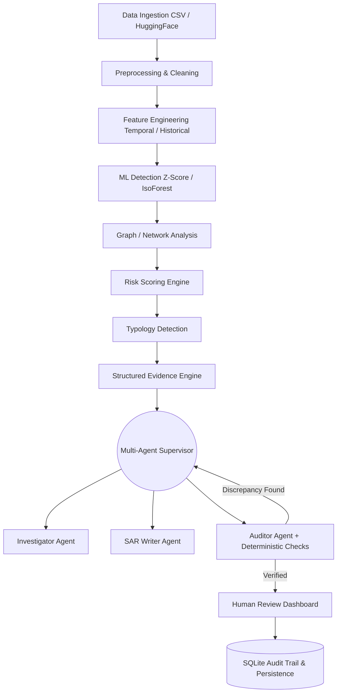

<div align="center">


# 🛡️ SAR-AI: Multi-Agent Suspicious Activity Report Generation System

**An AI-powered compliance automation system that detects suspicious financial transactions and generates regulatory Suspicious Activity Reports (SARs) using a multi-agent LLM architecture.**

*Built for AML / Financial Crime Compliance research and prototyping.*

[Features](#-key-features) · [Architecture](#-architecture) · [Data Pipeline](#-data-pipeline) · [Agents](#-multi-agent-architecture) · [Quickstart](#-installation--setup) · [Limitations](#-limitations)

</div>

---

## 📌 Problem Statement

Financial institutions process hundreds of millions of transactions daily. Detecting suspicious activity and generating the required regulatory reports (SARs) is a time-consuming, largely manual process — costly in both time and compliance risk. Human analysts must gather evidence across multiple systems, synthesize network graphs, and manually draft formal compliance narratives.

## 💡 Solution

**SAR-AI** automates this end-to-end workflow by combining:
- **Statistical anomaly detection** to identify transactions that deviate from expected patterns.
- **Multi-factor risk scoring** to evaluate statistical, historical, and network signals.
- **Multi-agent LLM orchestration** utilizing specific agents to investigate, draft, and rigorously audit SAR narratives.
- **Deterministic Factual Validation** to ensure LLMs do not invent or hallucinate transaction facts.

> ⚠️ **Disclaimer:** This is a research prototype built for a hackathon. It is not intended for production deployment in regulated environments. The generated outputs are "research/prototype SAR narratives." Human review is mandatory. This system does NOT automatically file official regulatory reports.

---

## ✨ Key Features

- **Schema-Agnostic Ingestion:** Automatically maps and cleans CSV or Hugging Face datasets.
- **Machine Learning Detection:** Employs Z-Score and Isolation Forest anomaly detection.
- **Graph & Network Analysis:** Detects cyclic transaction patterns and tracks counterparty counts.
- **Structured Evidence Engine:** Pre-assembles factual, deterministic payloads prior to LLM interaction to completely eliminate factual hallucination.
- **Multi-Agent Orchestration:** A Supervisor agent routes tasks between an Investigator, SAR Writer, and an adversarial Auditor.
- **Deterministic Auditing:** Verifies exact transaction amounts, dates, and IDs against the generated narrative.
- **Local & Cloud LLM Support:** Privacy-preserving local execution (Ollama) or high-performance cloud execution (Gemini).
- **Persistent Audit Trail:** SQLite-backed storage tracks investigations, agent reasoning chains, and human reviewer decisions.
- **Compliance Dashboard:** A comprehensive Streamlit interface for exploration, detection, investigation, and auditing.

---

## 🏗️ Architecture

SAR-AI relies on a decoupled, modular architecture passing data from ingestion through detection, and finally into a state-managed LLM workflow.



---

## 📊 Data Pipeline & Dataset Sources

### Dataset Sources
SAR-AI supports synthetic or public transaction datasets.
- **Format:** CSV files (e.g., `data/sample_transactions.csv`) or direct integration via the Hugging Face `datasets` library.
- **Requirements:** Datasets must contain at minimum an `amount` column. `transaction_id`, `sender` (or `customer_id`), `receiver`, and `timestamp` are highly recommended for optimal feature engineering.

### Dataset Loading
Loading is managed by `data/ingestion/dataset_registry.py`. It dynamically maps column schemas (e.g., `Value` -> `amount`, `Date` -> `timestamp`). 

### Preprocessing
Managed by `data/preprocessing/preprocessor.py`. Automatically handles NaN imputation, numeric casting, duplicate removal, and basic sanity checks.

---

## 🧠 ML Pipeline

### Feature Engineering
The `features/engineer.py` module creates highly predictive signals:
- **Historical:** `sender_txn_count`, `sender_avg_amount`, `historical_deviation` (expanding Z-score per customer).
- **Temporal:** `time_since_last_txn_sec`, `is_burst_activity` (transactions < 60s apart).
- **Network:** Unique counterparties up to the current transaction.

### Anomaly Detection
Found in `detection/`:
- **Z-Score Detector:** Flags statistical outliers (Z > 2.0).
- **Isolation Forest:** Multi-dimensional outlier detection using `scikit-learn`.

### Entity/Network Analysis
Found in `analysis/network.py`. Builds a directed graph using `networkx` to detect topological risks, specifically circular transactions (A -> B -> C -> A).

### Typology Detection
Found in `analysis/typologies.py`. Maps combinations of the above signals to standard AML typologies:
- *Structuring*
- *High-Value Anomaly*
- *Unusual Burst Activity*
- *Circular Transaction Pattern*

### Risk Scoring
Found in `risk/scorer.py`. Computes a composite 0-100 score using weighted inputs:
- 30% Anomaly Magnitude
- 30% Historical Deviation
- 20% Burst Activity
- 20% Network Topology (Cycles / Counterparties)
Outputs a Risk Level: Low (0-29.99), Medium (30-59.99), High (60-79.99), or Critical (80-100).

---

## 🤖 Multi-Agent Architecture

The LLM architecture is orchestrator-led and state-driven, located in `agents/`.

### Evidence Engine
Before *any* LLM is invoked, `evidence/engine.py` builds a deterministic `EvidencePackage`. This strict Pydantic model contains the flagged transaction, counterparty history, risk scores, and typologies. **LLMs are never asked to invent or calculate facts.**

### Agent Workflow
1. **Supervisor Agent:** Manages the `InvestigationState`. Routes the evidence package through the system.
2. **Investigator Agent:** Summarizes the raw `EvidencePackage` into a coherent investigative brief.
3. **SAR Writer Agent:** Drafts a formal, structured compliance narrative based *strictly* on the brief.
4. **Auditor Agent:** Critiques the draft.

### Deterministic Validation
Before the Auditor Agent provides semantic feedback, `agents/validators.py` runs a suite of Python-based regex and string-matching checks. It ensures that the exact `amount`, `transaction_id`, and `date` present in the `EvidencePackage` are accurately represented in the LLM's draft. If a hallucination is detected, the Supervisor forces the SAR Writer to rewrite the draft (up to a retry limit).

---

## 🖥️ Dashboard & Human Review

The Streamlit dashboard (`ui/dashboard.py` and `ui/pages/`) serves as the primary interface.

- **Data Explorer:** Browse ingested transactions.
- **Detection:** Run ML pipelines and visualize anomalies on scatter plots.
- **Investigation & Review:** Select a flagged transaction, watch the Multi-Agent system process it in real-time, and read the deterministic audit results.
- **Human Review:** A human *must* click "Approve & Log" or "Reject". 
- **Audit Trail:** View the SQLite-backed operational history.

---

## 📁 Project Structure

```text
sar-ai-project/
├── agents/             # Investigator, Writer, Auditor, Supervisor, Validators
├── analysis/           # Typology and Network/Graph analysis
├── app/                # Application entry points and structured logger
├── data/               # Ingestion, schema mapping, preprocessing
├── detection/          # Z-Score and Isolation Forest detectors
├── evaluation/         # ML and LLM pipeline evaluation scripts
├── evidence/           # Deterministic Evidence Engine
├── features/           # Temporal and historical feature engineering
├── llm/                # LLM Provider factory (Ollama, Gemini, Mock)
├── risk/               # Multi-factor Risk Scorer
├── scripts/            # CLI utilities (run_evaluation.py)
├── storage/            # Persistence (SQLite and JSONL)
├── tests/              # Extensive Pytest suite
├── ui/                 # Streamlit multi-page dashboard
└── main.py             # CLI application entry
```

---

## 🚀 Installation & Setup

### 1. Requirements
- Python 3.10+
- Git

### 2. Installation
```bash
git clone https://github.com/yourusername/sar-ai-project.git
cd sar-ai-project
python -m venv venv
source venv/bin/activate  # On Windows: venv\Scripts\activate
pip install -r requirements.txt
```

### 3. Environment Configuration
Create a `.env` file based on the provided template:
```bash
cp .env.example .env
```
Open `.env` and configure your preferred LLM provider (`ollama` or `gemini`) and storage backend (`sqlite` or `jsonl`).

### 4. LLM Provider Setup

**Option A: Local Privacy-Preserving (Ollama)**
1. Install [Ollama](https://ollama.com).
2. Pull the model: `ollama pull llama3`
3. Start the server: `ollama serve`
4. In `.env`, set `LLM_PROVIDER=ollama`.

**Option B: Cloud High-Performance (Gemini)**
> ⚠️ **Warning:** Do not use cloud models with real, private financial data without explicit organisational approval.
1. Obtain a Gemini API Key from Google AI Studio.
2. In `.env`, set `LLM_PROVIDER=gemini` and `GEMINI_API_KEY=your_key`.

### 5. Hugging Face Dataset Setup
To use public datasets from Hugging Face, ensure you have the `datasets` library installed (included in `requirements.txt`) and configure your dataset name in the `dataset_registry.py` or UI.

---

## 🏃 Running Instructions

### Streamlit Dashboard (Recommended)
```bash
streamlit run ui/dashboard.py
```
Navigate to `http://localhost:8501`.

### CLI Batch Execution
Run the end-to-end pipeline via CLI for either local CSV data or Hugging Face streaming datasets:
```bash
# Run using local CSV (default: data/sample_transactions.csv)
python -m app.main --source csv

# Run using Hugging Face streaming dataset (default: eexzzm/IBM-Transactions-for-Anti-Money-Laundering-HI-Small-Trans)
python -m app.main --source hf --max-records 100
```
This runs ingestion, preprocessing, ML anomaly detection, multi-factor risk scoring, typology identification, evidence compilation, multi-agent investigation & drafting, factual validation, and persistent audit logging to SQLite and the configured `AUDIT_LOG_PATH`.

---

## 🧪 Testing & Evaluation

### Testing
SAR-AI includes an extensive `pytest` suite covering feature engineering, detection, multi-agent workflows, edge cases, error handling, and storage.
```bash
python -m pytest tests/
```

### Evaluation
The evaluation module measures deterministic factual coverage, unsupported claims, and missing evidence. (It purposefully does *not* invent subjective LLM "quality" percentages).
```bash
python scripts/run_evaluation.py
```
> Note: ML metrics (Precision, Recall, ROC-AUC) are only computed if the loaded dataset contains verified ground-truth labels.

---

## 🔒 Security & Privacy Considerations

- **Environment Variables:** All secrets (API keys) are managed via `.env` and excluded from source control (`.gitignore`).
- **Local Inference:** The default configuration uses Ollama, ensuring sensitive transaction data never leaves the host machine.
- **Cloud LLM Warning:** Using the Gemini API transmits data to Google servers. Ensure you are only using synthetic, anonymized, or public data when operating in this mode.

---

## ⚠️ Limitations

- **Prototype Status:** This system is not regulatory certified.
- **Rule Thresholds:** ML anomaly detection thresholds and risk weights are currently heuristic and should be calibrated against institutional historical data.
- **Scale:** Currently optimized for batch processing of CSVs. Not designed for high-throughput streaming (e.g., Kafka) out-of-the-box.
- **Storage:** SQLite is suitable for local research but should be replaced with PostgreSQL for concurrent enterprise use.

---

## 🗺️ Future Roadmap

- Integrate Kafka/Kinesis for real-time transaction streaming.
- Implement PostgreSQL for the `StorageProvider` abstraction.
- Enhance SHAP/LIME integration for deeper explainability on Risk Scores.
- Integrate fine-tuned open-source compliance models specifically trained on regulatory typologies.

---

## 📜 License

This project is licensed under the MIT License.
